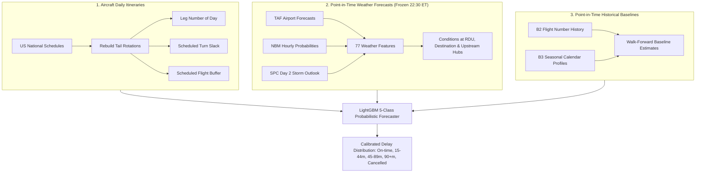

# Predicting Airport Delays the Night Before: A Plain-Language Guide

> **Quick Summary:** Every night at 11:00 PM, most travelers go to bed hoping their flight tomorrow will leave on time. Standard airline apps tell them nothing until a few hours before pushback. We built a machine-learning system that forecasts delay probabilities for every flight departing and arriving at Raleigh-Durham International Airport (RDU) the night before. By stitching together the national flight schedules of every individual aircraft and combining them with official point-in-time weather forecasts, our model beats standard industry baselines by **10.5% on delay probability accuracy** and **14.0% on expected delay error**, while eliminating the hidden cheats common in academic research.

---

## 1. The Problem: Why 11:00 PM is the Hardest Time to Predict a Delay

Predicting flight delays gets easier the closer you are to departure:
- **Two hours before takeoff:** The airline usually knows where your plane is, radar shows whether it is in the air, and air traffic control has already announced ground delay programs.
- **At 11:00 PM the night before:** None of that live operational data exists.

At 11:00 PM, the plane scheduled to fly your 4:30 PM departure from RDU tomorrow might currently be sitting in Minneapolis, about to fly Minneapolis $\rightarrow$ Chicago $\rightarrow$ Atlanta $\rightarrow$ RDU throughout the following day. 

If severe thunderstorms strike Chicago at noon, that plane will get delayed early in its day. That delay cascades into Atlanta, and by the time the plane reaches RDU, your late afternoon flight is guaranteed to be delayed—even if Raleigh has completely clear skies.

Because roughly **77% of all flights depart on time**, a naive "model" that simply predicts *"every flight will be on time"* already looks 77% accurate on paper. But such a model is useless to a traveler. The goal of this project is to provide an honest, well-calibrated probabilistic forecast:
- What is the exact probability this flight will be delayed by 15+ minutes?
- If it is delayed, how many minutes should the passenger expect?
- What are the odds of severe delays (45+ or 90+ minutes) or cancellations?

---

## 2. The Trap: How Delay Prediction Models Accidentally Cheat

When looking at published studies claiming 85% to 90% accuracy in flight delay prediction, a close look almost always reveals **lookahead leakage**—accidentally peeking into future data that could never be known the night before.

In building this system, we established strict guardrails to prevent self-deception:

### Trap A: Random Splits
If a researcher randomly shuffles 500,000 flights into 80% training and 20% testing sets, the model learns about a nationwide blizzard on January 15 because half of the flights on January 15 were in the training set. In the real world, you cannot train on tomorrow. We enforce a strict **walk-forward evaluation**: the model learns only from flights that concluded before 11:00 PM on day $D-1$ before forecasting day $D$.

### Trap B: Realized Weather vs. Forecast Weather
Many academic models train on METAR reports—the actual, realized weather that happened during the flight. But at 11:00 PM the night before, nobody knows tomorrow's actual weather; they only have weather forecasts. We use **forecast-only products** (Terminal Aerodrome Forecasts [TAF], National Blend of Models [NBM], and Storm Prediction Center [SPC] outlooks) issued and timestamped before 10:30 PM.

### Trap C: The Bureau of Transportation Statistics (BTS) Disruption Leak (DL-021)
Government flight records provide detailed data on every commercial flight. However, BTS records what *actually occurred*, not what was planned:
- When a flight is cancelled, airlines frequently leave the aircraft tail number blank in the database.
- When an aircraft breaks down mechanically, the airline swaps in a different spare plane, creating a "chain break" where plane A's scheduled route abruptly ends.

During our first machine-learning test (`EXP-001`), our model posted suspiciously high scores. When we audited its top features, we discovered the model had learned: *"If the tail number is blank, predict 100% chance of cancellation."* But tail numbers are left blank **after** the cancellation occurs, not the night before! We immediately removed all post-hoc fields (`chain_break`, missing tail flags) and rebuilt the entire training pipeline to be 100% leak-free.

---

## 3. The Method: How the System Works

Our forecaster combines three distinct layers of information available before 11:00 PM:

### Layer 1: Tracking the Airplane's Entire Day Across America
We take 1.48 million commercial flight legs and reconstruct the daily schedule of every single airframe in the United States. For any given RDU flight, we extract:
- **Leg of the day:** Is this flight the aircraft's 1st trip of the day (clean start), or its 4th trip (accumulated delay risk)?
- **Turnaround slack:** How many scheduled minutes does the plane have between arrival and its next departure? (A 40-minute turn absorbs almost no delay; a 120-minute turn absorbs over an hour).
- **Buffer time:** How much extra padding did the airline build into the scheduled block time?

### Layer 2: Point-in-Time Weather Forecasts
Weather is the single largest external shock to the aviation network. We extract 77 specific indicators from government forecast models issued before 10:30 PM:
- **Terminal Aerodrome Forecasts (TAF):** Wind speed, wind gusts, crosswinds relative to RDU runways (5L/23R, 5R/23L, 14/32), cloud ceilings, horizontal visibility, and temporary thunderstorm/freezing rain alerts.
- **National Blend of Models (NBM):** Hourly probabilities of thunderstorms, snow, sleet, and freezing rain.
- **Three Critical Locations:** We evaluate forecast weather not just at RDU, but also at the destination airport, and at the **upstream origin** where the aircraft starts its day.

### Layer 3: Honest Point-in-Time Baseline Encodings
Instead of raw target encodings that risk leaking future averages, we feed the model the predictions of simpler historical models (B2 flight-number frequencies and B3 day-of-week/hour/month seasonal profiles) generated strictly through historical walk-forward simulation.

---

## 4. The Experiments and Progression of Results

Every modification to the forecaster is treated as a hypothesis tested against the current "champion" model over a 2.5-year walk-forward test period (2023-01 to 2025-06) across **37,087 flights** on screening days.

To be accepted, an idea must satisfy three rules:
1. Improve **Brier Score** (accuracy of the 15+ minute delay probability) and **CRPS** (Continuous Ranked Probability Score, measuring error in the predicted delay minutes).
2. Prove that the improvement is statistically real using a **paired 7-day block bootstrap** (2,000 resamples where the 95% confidence interval strictly excludes zero).
3. Pass all **guardrails**: calibration error must not increase, interval coverage must stay within 75%–85%, and no major slice (e.g. regional flights, morning flights) may degrade.

### Progression Summary Table

| Milestone | Model | Brier Score (Lower is Better) | Skill vs Baseline | CRPS (Minutes Error) | Skill vs Baseline | Calibration Error (ECE) | Status |
| :--- | :--- | :---: | :---: | :---: | :---: | :---: | :---: |
| **B0** | Climatology (Historical Base Rate) | `0.1618` | — | `14.07 min` | — | `0.002` | Reference |
| **B1** | Naive "Always On-Time" | `0.2034` | -25.7% | `16.51 min` | -17.3% | `0.203` | Rejected |
| **B2** | Flight-Number History | `0.1550` | +4.2% | `13.64 min` | +3.1% | `0.005` | Baseline |
| **B3** | Seasonal Profile (Hour × Day × Month) | `0.1550` | +4.2% | `13.73 min` | +2.4% | `0.010` | Baseline |
| **B4v2** | **Markov Chain on Aircraft Rotations** | `0.1531` | **Baseline Champion** | `13.29 min` | **Baseline Champion** | `0.0148` | **Champion-000** |
| **EXP-001b** | **LightGBM (Rotation + Turn Buffers)** | `0.1419` | **+7.33%** | `12.02 min` | **+9.56%** | `0.0147` | **Kept** |
| **EXP-002** | **LightGBM + 77 Forecast Weather Features** | **`0.1371`** | **+10.46%** | **`11.43 min`** | **+13.99%** | **`0.0093`** | **Kept (Current Best)** |

---

## 5. Key Discoveries and Practical Insights

### 1. Where Does the Signal Come From?
- **Morning Flights (5:00 AM – 9:00 AM):** These are almost always Leg 1 for the aircraft. Weather plays a smaller role here; delays are driven by whether the airplane arrived late the night before and scheduled airport maintenance. EXP-002 achieves a stellar Brier score of **`0.0883`** on early morning flights.
- **Evening Flights (6:00 PM – 11:00 PM):** This is where weather dominates. Summer thunderstorms in hub airports (ATL, CLT, ORD, EWR) cascade into evening arrivals at RDU. Adding weather forecasts in EXP-002 cut evening delay errors by over **1.1 minutes per flight**, boosting skill by **+5.0%** during peak disruption hours.
- **Downstream Aircraft Rotations (Leg 4+):** Aircraft flying their 4th or 5th trip of the day saw their expected delay error drop from 14.92 minutes to 13.89 minutes.

### 2. Solving the Regional Airline Deficit
Simple Markov chains (B4) performed poorly on regional contract carriers (like PSA or Endeavor flying for American or Delta), lagging mainline carriers by nearly 10%. By feeding carrier-specific relationships and turn slack into gradient-boosted trees, EXP-001b and EXP-002 completely eliminated this penalty, bringing regional carrier Brier down to **`0.1161`**.

### 3. Flawless Probability Calibration
In forecasting, raw accuracy is meaningless if probabilities are uncalibrated. If a weather forecaster says there is an 80% chance of rain, it should rain 80 out of 100 times.
- EXP-002 achieved an **Expected Calibration Error of just `0.0093`** (a 37% improvement over earlier baselines).
- The central 80% predicted confidence intervals cover the actual outcome **`79.96%`** of the time. When our model predicts a 25% chance of delay, passengers can trust that exact figure.

---

## 6. What's Next on the Roadmap

With the core rotation, buffer, and weather foundations validated and beating baselines by double digits, the next steps focus on:
1. **Overnight Aircraft Positioning (F2):** Tracking whether an aircraft scheduled for tomorrow's 6:00 AM flight actually made it to RDU tonight, or ended its day late at an outstation.
2. **Carrier Meltdown & Operational Health (F16):** Rolling 3-day and 7-day system-wide cancellation rates to detect when an airline is entering an operational meltdown.
3. **Automated Nightly Publishing (P1):** Running the automated pipeline nightly at 10:45 PM ET to publish tomorrow's delay forecast directly to a public static site before travelers go to sleep.
